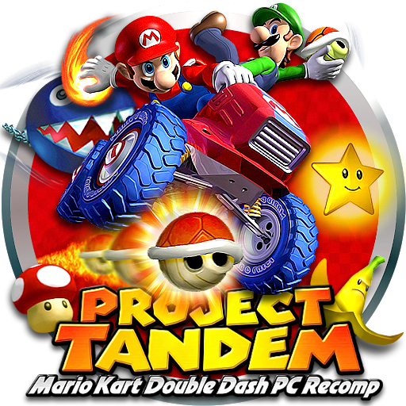
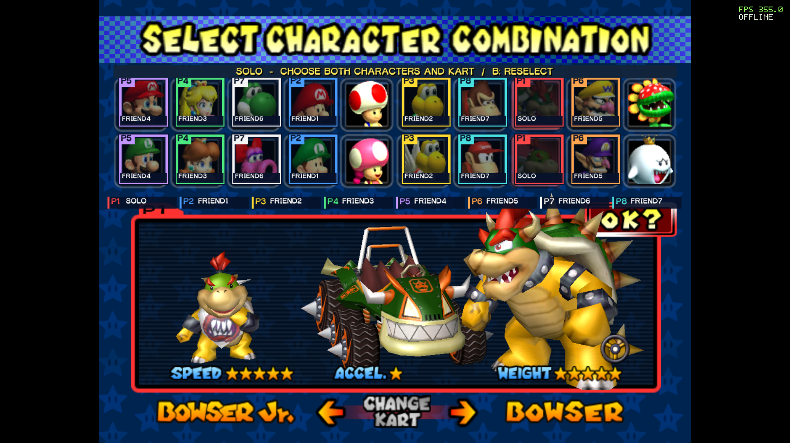

  
   Artwork by <a href="https://www.deviantart.com/pooterman">POOTERMAN</a> · <a href="https://github.com/badcompany94-rcmp/project-tandem/issues/11">Original contribution</a>. Thank you for this awesome artwork!

# Project Tandem — Mario Kart: Double Dash!! Online on PC

Play *Mario Kart: Double Dash!!* online with friends on Windows. Project Tandem is a native PC port and static recompilation project for the GameCube game, with 2–16 player online multiplayer, solo or shared karts, natural widescreen, modern controllers, and automatic menu/racing mouse and keyboard controls.

**Downloads:** [Windows — official Public Beta 9 (experimental)](https://github.com/badcompany94-rcmp/project-tandem/releases/tag/v0.1.0-beta.9) · **[Linux — community build by slex2jf](https://github.com/slex2jf/Project-Tandem-Linux)**

[Installation and updates](docs/INSTALLATION.md) · [Controls](docs/CONTROLS.md) · [Online play](docs/ONLINE.md)

The Linux adaptation is maintained separately by slex2jf. Windows/Linux online compatibility has not yet been verified.

**Bring your own compatible disc image.** Project Tandem verifies your USA `GM4E01` ISO/CISO and recompiles the game on your PC. Downloads contain the recompiler, runtime, project features, and installation tools. They do not include a disc image or a compiled copy of the game.

**Online requires matching builds.** Everyone joining a room must use the same build ID. Update every player's installation before hosting or joining after an update; different builds cannot play together. Controller settings, trigger click points, and display options may differ. See [online play](docs/ONLINE.md).

**Beta 9 fixes Linux source compilation in the online menu**, thanks to [malespiaut](https://github.com/malespiaut). Windows menu machine code is unchanged by the fix. The launcher also uses POOTERMAN's fan-art icon in the Windows taskbar. This release retains automatic Windows updates and experimental networking/display features; it does not add a packaged Linux/Steam Deck installer. [Changes, compatibility and validation](docs/releases/public-beta-9.md) · [Launcher guide](docs/LAUNCHER.md) · [Previous Beta 8](https://github.com/badcompany94-rcmp/project-tandem/releases/tag/v0.1.0-beta.8)

## Features

- **Mouse and keyboard menus, separate racing controls.** Click through the offline and online menus, type names and room codes, then enter a race with a dedicated driving layout. The controls switch automatically. Race bindings stay active through race results and the award ceremony, and can be rebound in F1.
- **Switch between mouse/keyboard and controller.** Player one accepts both by default: use a mouse in the lobby and pick up a controller to drive. F1 also supports explicit device assignments.
- **Online play for 2–16 people.** Host a private room with an eight-character code, or make it public in the searchable lobby browser. Nearby LAN rooms appear first. Up to eight drivers and eight passengers share eight karts; solo and shared karts can race together.
- **Grand Prix and Battle.** Play a cup with CPUs filling Grand Prix slots, or compete in Balloon Battle, Shine Thief, and Bob-omb Blast. Battle requires at least two opposing karts.
- **Shared character selection.** Everyone sees live player markers and named, locked choices on the original character grid, with their own kart preview below. Solo players choose two characters; shared teammates choose one each.
- **Stay together between events.** Return to the same lobby, change seats and modes, edit your name, and keep session medal stars.
- **Natural 16:9 widescreen.** See more of the course with correctly proportioned HUD elements. Choose common 16:9 resolutions, windowed mode, fullscreen, or borderless fullscreen.
- **Controller and local multiplayer settings.** Xbox, PlayStation, and Switch controller support through SDL, rebindable controls, and separate device assignments for offline GameCube ports.
- **GameCube USB adapters on Windows.** Experimental native support for Nintendo-compatible Wii U/Switch-mode adapters, with four separately assignable ports, analog triggers and rumble. Requires an existing compatible WinUSB driver. [Supported hardware and testing limits](docs/GAMECUBE-ADAPTERS.md).
- **Windows launcher with automatic updates.** Play, set up/repair, check for releases and install updates from one window. Downloads are verified, failed updates roll back, and interrupted updates recover on reopening. [Launcher guide](docs/LAUNCHER.md).
- **Online prediction and adaptive buffering.** Peer-to-peer gameplay uses EOS connection setup and relay fallback. The optional F10 overlay shows FPS, RTT, and the current input buffer; it defaults off on fresh settings. Performance depends on the PCs and connection.
- **Portable setup and updates.** Compiler tools are bundled. Beta 8 and later can install updates in the launcher; cumulative ZIPs remain available for manual updates. Saves and settings stay in `local-data`.

## Install on Windows

1. Open **[Releases](https://github.com/badcompany94-rcmp/project-tandem/releases)** and download the Windows full package. GitHub's automatic **Source code** archives are for development, not the player installer.
2. Extract the ZIP completely into a writable folder.
3. Run `Setup-Tandem.cmd` and select your own supported USA ISO/CISO.
4. Allow setup to verify the disc and compile locally, then open **Project Tandem.lnk** or **ProjectTandem.exe**. The existing `Launch-Tandem.cmd` remains available.

The player package includes its build tools. You do not need Visual Studio, a separate Windows SDK, or Python installation. Online players do not need an Epic player account or developer setup. Ordinary home connections use automatic connection setup and relay fallback without a VPN or manual port forwarding; restrictive networks can still prevent a connection.

Requirements: 64-bit Windows 10 or 11, graphics supporting desktop OpenGL 3.3, a writable installation folder, and space for the toolchain, build output, and a private cached copy of your ISO. This beta targets Windows x64.

The supported disc is **USA `GM4E01`**, with `main.dol` SHA-1 `e389e50357d4a5076ab3d38672204658f411123d`. Setup rejects an incompatible revision. Other regions and RVZ/GCZ input are not supported by this installer.

[Installation and updates](docs/INSTALLATION.md) · [Controls](docs/CONTROLS.md) · [Online play](docs/ONLINE.md) · [Troubleshooting](docs/TROUBLESHOOTING.md)

## Mouse and keyboard controls

### Menus

| Input | Action |
| --- | --- |
| Mouse | Point at and highlight a menu choice |
| Left click | Select or confirm |
| Right click or Escape | Go back; confirmation appears when leaving a lobby |
| Arrow keys | Navigate |
| Enter | Confirm |
| Backspace | Go back |
| Typing | Enter your name or room code in an active text field |
| F1 | Open settings |

Mouse clicks also advance the introductions and the initial save prompt. Menu controls change automatically when racing begins; no manual profile switch is needed.

### Racing

| Input | GameCube action |
| --- | --- |
| Left click | A — accelerate |
| Right click | B — brake/reverse |
| A / D | Main stick left/right — steer |
| W / S | Main stick up/down |
| Space | X — use item |
| Q | Y — use/pass item |
| E | Z — switch riders |
| Left Shift | R trigger — drift |
| Ctrl | L trigger |
| Arrow keys | D-pad |
| Enter or Escape | Pause offline / open the online menu |

Race bindings remain active between races and through the award ceremony: **left click confirms** those screens. Arrow keys navigate result/pause choices and Enter confirms. F1 settings remain available, and all race bindings can be changed there.

Player one can use a controller at any time alongside mouse/keyboard unless you explicitly assign devices in F1. Xbox defaults keep A/B/X/Y matched to their labels, RB is Z, and Menu is Start. Other controller layouts can be customized in F1.

## Play with friends

Choose **Online Play → Host Room** and share the private room code, or switch the room to Public for discovery. Join using the code keypad, **Browse Public Lobbies**, or **F1 → Online → Quick join**. Use the same launcher for LAN and Internet rooms. Pick seats, ready up, and let the host choose the mode. All players need the same version and build ID, shown in the lobby and settings.

Current compatibility: **Public Beta 9 - `000dbce82144c576`**, based on Alpha25 gameplay. The source portability change produces a new build ID, so Beta 8 and earlier cannot join. Update every player to Beta 9 before playing together. Display option choices may differ between players.

Use **F1 → Exit to desktop**, the window close button, or Alt+F4 to exit. Online services close automatically with the game.

## Updates and support

From Beta 8 onward, use **Check for updates → Install update** in the Windows launcher. Beta 7 and earlier need one manual update to receive it: close Tandem, copy **all** cumulative ZIP files into the folder containing `Launch-Tandem.cmd`, accept replacement and keep `local-data`. Run Launch-Tandem.cmd once to finish setup. Manual ZIP updates remain available for Alpha12 and later portable installs.

Report problems through this repository's Issues, using the bug-report form. Include the version/build ID, Windows version, player count, mode, and steps to reproduce. For network problems, include each player's FPS/RTT/BUF readings. Share only reviewed diagnostic excerpts; [the troubleshooting guide](docs/TROUBLESHOOTING.md) explains which files to keep private.

## Source and credits

Project Tandem builds on Ethan Nicholas's [mariokartdd-recomp](https://github.com/ethannicholas/mariokartdd-recomp) and [gcn-recomp](https://github.com/ethannicholas/gcn-recomp). The runtime statically translates PowerPC code from the user's disc image to C and compiles it locally.

Project source uses the [MIT License](LICENSE). Third-party libraries, fonts, artwork, and distributed runtime components have separate notices; see [credits](CREDITS.md), [third-party notices](THIRD-PARTY-NOTICES.md), [end-user terms](EULA.txt), and [privacy information](PRIVACY.md). The MIT license does not license Nintendo's game content or trademarks.

*Mario Kart: Double Dash!!*, GameCube, characters, and related marks belong to their respective owners. Project Tandem is an independent project and is not affiliated with or endorsed by Nintendo or Epic Games.
