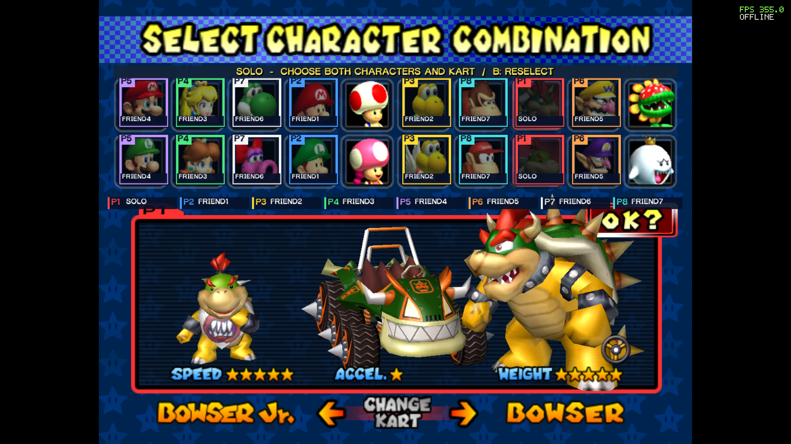

# Project Tandem

Play *Mario Kart: Double Dash!!* natively on Windows, with online shared-kart play, widescreen, modern controllers, and mouse and keyboard controls that adapt to what you are doing.

**Bring your own compatible disc image.** Project Tandem verifies your USA `GM4E01` ISO/CISO and recompiles the game on your PC. Downloads contain the recompiler, runtime, project features, and installation tools. They do not include a disc image or a compiled copy of the game.

## Features

- **Mouse and keyboard menus, separate racing controls.** Click through the offline and online menus, type names and room codes, then enter a race with a dedicated driving layout. The controls switch automatically. Race bindings stay active through race results and the award ceremony, and can be rebound in F1.
- **Switch between mouse/keyboard and controller.** Player one accepts both by default: use a mouse in the lobby and pick up a controller to drive. F1 also supports explicit device assignments.
- **Online play for 2–8 people.** Host a room and share its eight-character code. Take an empty kart or join a friend's back seat. Solo and shared karts can race together.
- **Grand Prix and Battle.** Play a cup with CPUs filling Grand Prix slots, or compete in Balloon Battle, Shine Thief, and Bob-omb Blast. Battle requires at least two opposing karts.
- **Shared character selection.** Everyone sees live player markers and named, locked choices on the original character grid, with their own kart preview below. Solo players choose two characters; shared teammates choose one each.
- **Stay together between events.** Return to the same lobby, change seats and modes, edit your name, and keep session medal stars.
- **Natural 16:9 widescreen.** See more of the course with correctly proportioned HUD elements. Choose common 16:9 resolutions, windowed mode, fullscreen, or borderless fullscreen.
- **Controller and local multiplayer settings.** Xbox, PlayStation, and Switch controller support through SDL, rebindable controls, and separate device assignments for offline GameCube ports.
- **Online prediction and adaptive buffering.** Peer-to-peer gameplay uses EOS connection setup and relay fallback. The F10 overlay shows FPS, RTT, and the current input buffer. Performance depends on the PCs and connection.
- **Portable setup and updates.** Compiler tools are bundled. Update by copying the full patch ZIP over your existing folder while preserving `local-data`.

## Install on Windows

1. Open **[Releases](https://github.com/badcompany94-rcmp/project-tandem/releases)** and download the Windows full package. GitHub's automatic **Source code** archives are for development, not the player installer.
2. Extract the ZIP completely into a writable folder.
3. Run `Setup-Tandem.cmd` and select your own supported USA ISO/CISO.
4. Allow setup to verify the disc and compile locally, then run `Launch-Tandem.cmd`.

The player package includes its build tools. You do not need Visual Studio, a separate Windows SDK, or Python installation. Online players do not need an Epic player account or developer setup. Ordinary home connections use automatic connection setup and relay fallback without a VPN or manual port forwarding; restrictive networks can still prevent a connection.

Requirements: 64-bit Windows 10 or 11, graphics supporting desktop OpenGL 3.3, a writable installation folder, and space for the toolchain, build output, and a private cached copy of your ISO. This beta targets Windows x64.

The supported disc is **USA `GM4E01`**, with `main.dol` SHA-1 `e389e50357d4a5076ab3d38672204658f411123d`. Setup rejects an incompatible revision. Other regions and RVZ/GCZ input are not supported by this installer.

[Installation and updates](docs/INSTALLATION.md) · [Controls](docs/CONTROLS.md) · [Online play](docs/ONLINE.md) · [Troubleshooting](docs/TROUBLESHOOTING.md)

## Mouse and keyboard controls

### Menus

| Input | Action |
| --- | --- |
| Mouse | Point at and highlight a menu choice |
| Left click | Select or confirm |
| Right click or Escape | Go back; confirmation appears when leaving a lobby |
| Arrow keys | Navigate |
| Enter | Confirm |
| Backspace | Go back |
| Typing | Enter your name or room code in an active text field |
| F1 | Open settings |

Mouse clicks also advance the introductions and the initial save prompt. Menu controls change automatically when racing begins; no manual profile switch is needed.

### Racing

| Input | GameCube action |
| --- | --- |
| Left click | A — accelerate |
| Right click | B — brake/reverse |
| A / D | Main stick left/right — steer |
| W / S | Main stick up/down |
| Space | X — use item |
| Q | Y — use/pass item |
| E | Z — switch riders |
| Left Shift | R trigger — drift |
| Ctrl | L trigger |
| Arrow keys | D-pad |
| Enter or Escape | Pause offline / open the online menu |

Race bindings remain active between races and through the award ceremony: **left click confirms** those screens. Arrow keys navigate result/pause choices and Enter confirms. F1 settings remain available, and all race bindings can be changed there.

Player one can use a controller at any time alongside mouse/keyboard unless you explicitly assign devices in F1. Xbox defaults keep A/B/X/Y matched to their labels, RB is Z, and Menu is Start. Other controller layouts can be customized in F1.

## Play with friends

Choose **Online Play → Host Room** and share the room code, or join using **Join Room** or **F1 → Online → Quick join**. Pick seats, ready up, and let the host choose the mode. All players need the same version and build ID, shown in the lobby and settings.

Current gameplay compatibility: **Alpha25 — `69b8a88ef96a4c0b`**. This public beta uses the Alpha25 gameplay build.

Use **F1 → Exit to desktop**, the window close button, or Alt+F4 to exit. Online services close automatically with the game.

## Updates and support

Close Tandem, copy **all** files from the cumulative update ZIP into the folder containing `Launch-Tandem.cmd`, and accept replacement. Keep `local-data`. The launcher rebuilds when needed. The cumulative package supports portable installations from Alpha12 onward.

Report problems through this repository's Issues, using the bug-report form. Include the version/build ID, Windows version, player count, mode, and steps to reproduce. For network problems, include each player's FPS/RTT/BUF readings. Share only reviewed diagnostic excerpts; [the troubleshooting guide](docs/TROUBLESHOOTING.md) explains which files to keep private.

## Source and credits

Project Tandem builds on Ethan Nicholas's [mariokartdd-recomp](https://github.com/ethannicholas/mariokartdd-recomp) and [gcn-recomp](https://github.com/ethannicholas/gcn-recomp). The runtime statically translates PowerPC code from the user's disc image to C and compiles it locally.

Project source uses the [MIT License](LICENSE). Third-party libraries, fonts, artwork, and distributed runtime components have separate notices; see [credits](CREDITS.md), [third-party notices](THIRD-PARTY-NOTICES.md), [end-user terms](EULA.txt), and [privacy information](PRIVACY.md). The MIT license does not license Nintendo's game content or trademarks.

*Mario Kart: Double Dash!!*, GameCube, characters, and related marks belong to their respective owners. Project Tandem is an independent project and is not affiliated with or endorsed by Nintendo or Epic Games.
